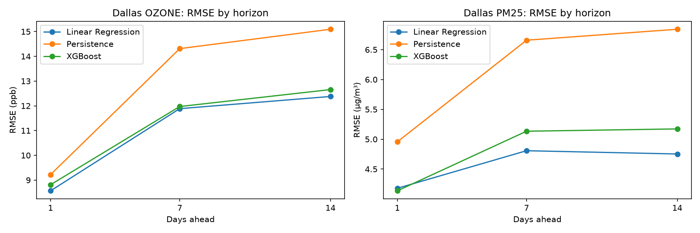
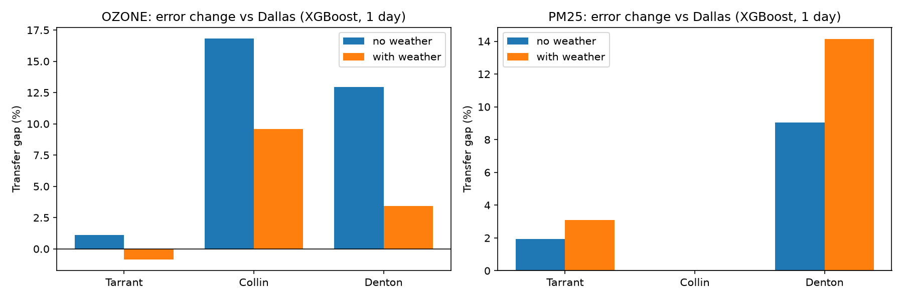
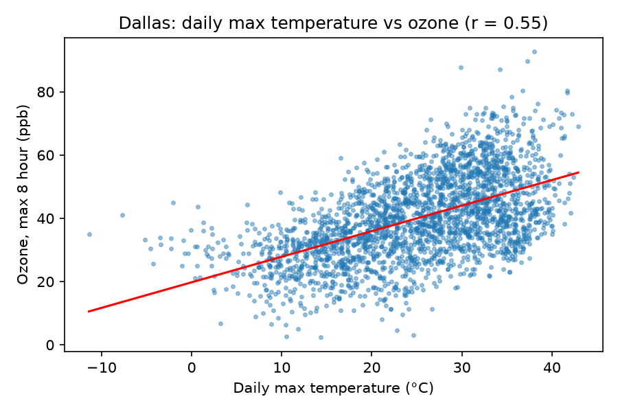

# Does a Dallas Air Quality Model Travel?

A small spatial transfer study: forecasting models trained only on Dallas County air quality data are tested on three neighboring North Texas counties (Tarrant, Collin, Denton) to see how much their error grows, and whether daily weather features shrink that growth.

## Motivation

This project was inspired by "Benchmarking Scientific Machine Learning Models for Air Quality Data" by Khawja Imran Masud, Venkata Sai Rahul Unnam and Sahara Ali (University of North Texas, D3 Lab), [arXiv:2603.21039v2](https://arxiv.org/abs/2603.21039). That paper benchmarks forecasting models for Dallas County only.

This repository is a small learning exercise that extends that work with one spatial question. It is **not** a replication of the paper: it uses its own simple features, models and evaluation.

## Research Question and Hypotheses

**Question:** When a model trained only on Dallas County data is used on Tarrant, Collin and Denton counties, how much does its error increase, and does adding daily weather features reduce that increase?

- **H1:** Error rises outside Dallas, but only slightly, since the counties share regional weather.
- **H2:** Weather features help ozone more than fine particulate matter (PM2.5, particles 2.5 micrometers or smaller), since ozone forms from heat and sunlight.
- **H3:** Persistence (tomorrow equals today) is hard to beat at 1 day ahead.

## Data

1. **United States Environmental Protection Agency (EPA) AirData daily files**, from `https://aqs.epa.gov/aqsweb/airdata/`
   - Ozone (parameter code 44201): the daily maximum 8 hour running average, converted from parts per million to parts per billion (ppb).
   - PM2.5 (parameter code 88101): the daily mean in micrograms per cubic meter (µg/m³).
   - Texas (State Code 48), counties Dallas (113), Tarrant (439), Collin (85) and Denton (121).
   - Years 2019 to 2025. When a county has several monitoring sites, their values are averaged per day. Single day gaps are filled by linear interpolation.
   - **Note:** Collin County had no PM2.5 data in 2025, so it is missing from the PM2.5 results.
2. **Open-Meteo historical weather archive** (`https://archive-api.open-meteo.com/v1/archive`, no key needed, timezone America/Chicago), one point per county:

   | County | Latitude | Longitude |
   |---|---|---|
   | Dallas | 32.78 | -96.80 |
   | Tarrant | 32.75 | -97.33 |
   | Collin | 33.20 | -96.62 |
   | Denton | 33.21 | -97.13 |

   Daily variables: maximum and mean temperature at 2 m, maximum wind speed at 10 m, mean relative humidity, total shortwave radiation and total precipitation.

Downloaded data is cached in `data/` and is not committed to the repository.

## Method

- **Features**, built separately for each county so that lags never cross county borders: today's value; the values 1, 2 and 6 days ago; the 7 day rolling average; month; day of week; and optionally the six weather variables for the day the forecast is made.
- **Horizons:** 1, 7 and 14 days ahead.
- **Models:**
  - Persistence: the forecast is today's value.
  - Linear Regression.
  - Extreme Gradient Boosting (XGBoost): 300 trees, maximum depth 4, learning rate 0.05, subsample 0.8, random seed 42.
- **Split:** train on Dallas only, using rows whose target date is in 2024 or earlier. Test on 2025 in all four counties.
- **Metrics:** Mean Absolute Error (MAE) and Root Mean Squared Error (RMSE).
- **Transfer gap:** how much worse a county is than Dallas, for the same model and features:

  `gap % = (RMSE in county - RMSE in Dallas) / RMSE in Dallas x 100`

  The average gap is the mean over Tarrant, Collin and Denton.

## Results

RMSE on the 2025 test year. Ozone is in ppb, PM2.5 in µg/m³. Full results, including MAE, are in [`results/results.csv`](results/results.csv) and [`results/results_table.csv`](results/results_table.csv).

**Ozone, 1 day ahead**

| Model | Features | Dallas | Tarrant | Collin | Denton | Avg gap % |
|---|---|---|---|---|---|---|
| Persistence | none | 9.22 | 9.35 | 10.88 | 10.62 | 11.54 |
| Linear Regression | no weather | 8.52 | 8.70 | 9.85 | 9.47 | 9.57 |
| Linear Regression | with weather | 8.57 | 8.64 | 9.60 | 9.12 | 6.45 |
| XGBoost | no weather | 8.75 | 8.85 | 10.22 | 9.88 | 10.31 |
| XGBoost | with weather | 8.81 | 8.74 | 9.66 | 9.11 | 4.06 |

**PM2.5, 1 day ahead** (Collin had no PM2.5 data in 2025)

| Model | Features | Dallas | Tarrant | Denton | Avg gap % |
|---|---|---|---|---|---|
| Persistence | none | 4.96 | 5.05 | 5.70 | 8.53 |
| Linear Regression | no weather | 4.27 | 4.32 | 4.84 | 7.33 |
| Linear Regression | with weather | 4.18 | 4.24 | 4.77 | 7.79 |
| XGBoost | no weather | 4.28 | 4.37 | 4.67 | 5.49 |
| XGBoost | with weather | 4.14 | 4.26 | 4.72 | 8.62 |

**Ozone, 7 days ahead, Dallas:** Persistence 14.31, Linear Regression 11.84, XGBoost 11.67 (no weather).

### Error by horizon in Dallas

Models shown with weather features, against persistence.



### Transfer gap with and without weather

XGBoost, 1 day ahead. Bars show how much worse each county is than Dallas.



### Heat and ozone

In Dallas, ozone rises about 0.81 ppb per 1 °C of daily maximum temperature (correlation r = 0.55).



## Findings

- **Weather roughly halves the ozone transfer gap at 1 day.** For XGBoost the average gap falls from 10.3% to 4.1%, and for Linear Regression from 9.6% to 6.5%. Dallas error itself barely changes (XGBoost 8.75 to 8.81 ppb). Weather is regional, so it carries over across counties.
- **Weather does not help PM2.5 transfer.** The XGBoost gap rises from 5.5% to 8.6%. This fits with PM2.5 depending more on local sources than on regional weather.
- **Transfer gaps shrink at longer horizons.** For ozone the average gaps are about 3% or less at 7 and 14 days (0.8% to 3.2% at 7 days). At both horizons, every model clearly beats persistence (Dallas ozone at 7 days: 11.7 to 12.0 ppb against 14.3 ppb).
- **Caveat: part of the gap means those counties are just harder to forecast.** Persistence itself is 15% to 18% worse in Collin and Denton than in Dallas. Compared with persistence *in the same county*, the Dallas trained XGBoost with weather improves 4.4% in Dallas but about 11% in Collin and 14% in Denton.
- **Hypothesis check:**
  - H1 mostly true: Tarrant's gap is small (about 2% or less), but Collin and Denton reach 11% to 17% without weather.
  - H2 true: weather narrows the ozone gap but widens the PM2.5 gap.
  - H3 partly wrong: at 1 day, Linear Regression beats persistence for ozone in Dallas by about 7% to 8% (XGBoost by about 4% to 5%).
- **XGBoost was not better than Linear Regression** with these simple features. For 1 day ozone in Dallas, Linear Regression had the lowest error (8.52 ppb against 8.75 ppb).

## Limitations

- One weather point per county, which ignores variation within a county.
- Actual observed weather is used rather than archived weather forecasts.
- Simple models with fixed settings and no tuning.
- Neighboring counties make this a mild transfer test.
- Collin County PM2.5 is missing for the test year.
- Built in about 1.5 days as a learning exercise.

## Open Questions

- Could the Air Quality Index (AQI) consistency loss from the D3 Lab paper also improve transfer across counties?
- Could causal discovery methods such as TS-CausalNN separate weather effects from emission effects?
- How would a harder transfer, such as Dallas to Houston, behave?

## How to Run

Requires Python 3.10 or newer.

```
pip install -e .
python scripts/run_all.py
pytest -q
```

The first run downloads the EPA and Open-Meteo data into `data/`, which can take a while if the EPA server is slow. Later runs use the cached files. Results go to `results/` and charts to `results/figures/`.

On macOS, XGBoost needs the OpenMP runtime: `brew install libomp`.

The original Colab notebook is in [`notebooks/dallas_aq_transfer.ipynb`](notebooks/dallas_aq_transfer.ipynb).

## Repository Layout

```
src/dallas_aq/      config, data download, features, experiments, report table, plots
scripts/run_all.py  runs the full pipeline
tests/              checks that targets are in the future and lags stay within a county
results/            results tables and figures
notebooks/          original Colab notebook
```

## Acknowledgment

Built with help from an AI coding assistant for packaging and plotting; the study design and evaluation logic were written and checked by the author.

## License

MIT License. See [LICENSE](LICENSE).
